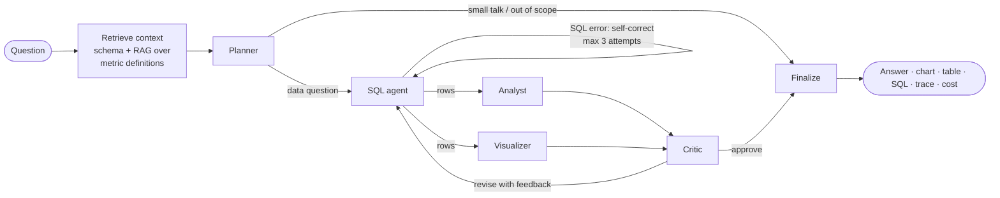

# InsightPilot

**A multi-agent data analyst built on Amazon Bedrock.** Ask a business question in plain English. A team of
specialised agents plans the analysis, writes SQL and fixes its own errors, interprets the results, picks a chart
and has a critic check the answer against the numbers. You watch each step stream in live.

Built with **LangGraph · Amazon Bedrock (Nova / Claude) · Titan Embeddings · FastAPI · DuckDB ·
PostgreSQL + pgvector · React + TypeScript**, and designed from day one to be deployed with Docker, GitHub Actions,
EC2, ECS Fargate and EKS.

---

## How it works



| Agent | Job | Guardrails |
|---|---|---|
| **Retrieve context** | Loads the dataset schema plus sample rows, and retrieves business definitions (e.g. *"revenue excludes returned orders"*) from a pgvector knowledge base | Top-k semantic search with Titan Embeddings v2 |
| **Planner** | Classifies intent, breaks the question into steps, decides whether a chart helps | Short-circuits greetings and out-of-scope questions, so no SQL runs for them |
| **SQL agent** | Writes DuckDB SQL, executes it, reads the error and retries | `sqlglot` AST validation (single read-only SELECT, no file functions), then a sandboxed DuckDB with external access disabled and config locked |
| **Analyst** | Answers using *only* the returned rows, adds insights and follow-ups | Runs in parallel with the visualizer (LangGraph fan-out/fan-in) |
| **Visualizer** | Chooses bar / line / pie / scatter and the axes | Column names validated against the result, with a deterministic fallback when the model hallucinates |
| **Critic** | Checks that the SQL answers the question, that definitions were respected, and that every number appears in the results | Can send the SQL agent back once with specific feedback |

Every LLM call uses the **Bedrock Converse API with forced tool use**, so each agent returns schema-validated JSON
instead of free text. Every run is persisted with its SQL, trace, token usage and estimated cost.

## Highlights

- **Agentic patterns**: planning, tool use, self-correction loops, parallel fan-out/fan-in, reviewer/critic loop, RAG
- **Model-agnostic**: switch between Amazon Nova, Anthropic Claude and others with one env var (`BEDROCK_MODEL_ID`)
- **Safe text-to-SQL**: two independent layers of defence against destructive or data-exfiltrating SQL
- **Live streaming**: Server-Sent Events from LangGraph through FastAPI and nginx to React
- **Production concerns**: structured JSON logs with request IDs, Prometheus `/metrics`, liveness/readiness
  probes, cost tracking, optional API-key auth, non-root multi-stage images, 12-factor config
- **Cloud-ready storage**: datasets on local disk or **S3** and history in SQLite or **PostgreSQL/RDS**,
  switched by environment variables
- **Fully testable offline**: a deterministic fake LLM lets the whole graph run in CI with no AWS credentials

## Tech stack

| Layer | Choice |
|---|---|
| Agents | LangGraph `StateGraph` |
| LLM | Amazon Bedrock Converse API (default `us.amazon.nova-lite-v1:0`) |
| Embeddings / RAG | Amazon Titan Text Embeddings v2 + PostgreSQL **pgvector** |
| API | FastAPI, Pydantic v2, SSE streaming |
| Analytics engine | DuckDB (in-memory, sandboxed) |
| Persistence | SQLAlchemy 2 (SQLite locally, PostgreSQL in Docker / RDS) |
| Frontend | React 18, TypeScript, Vite, Tailwind (token-based design system), Radix UI, TanStack Query, Chart.js |
| Serving | nginx (static assets + reverse proxy), Uvicorn |
| Observability | Prometheus metrics, JSON logs |
| Quality | pytest (30 tests), ruff, `tsc --strict` |

## Quick start (no Docker, no AWS)

Requires Python 3.12+ and Node 20+.

```bash
# 1. Backend (offline fake LLM by default)
cd backend
python -m venv .venv
.venv\Scripts\activate            # Windows  (macOS/Linux: source .venv/bin/activate)
pip install -r requirements-dev.txt
uvicorn app.main:app --reload     # http://localhost:8000/docs

# 2. Frontend (new terminal)
cd frontend
npm install
npm run dev                       # http://localhost:5173
```

The sample `ecommerce` dataset is preloaded: 800 customers, 4.4k orders and 7.7k order lines across 2024–2025.

### Use real Amazon Bedrock

1. In the AWS console, open **Bedrock → Model access** in `us-east-1` and make sure **Amazon Nova Lite** and
   **Titan Text Embeddings V2** are available to your account.
2. Configure credentials locally: `aws configure` (an IAM user with `bedrock:InvokeModel`).
3. Create `backend/.env` from [.env.example](.env.example) and set:

   ```env
   LLM_PROVIDER=bedrock
   EMBEDDING_PROVIDER=bedrock
   AWS_REGION=us-east-1
   BEDROCK_MODEL_ID=us.amazon.nova-lite-v1:0
   ```

4. Restart the API. Each answered question makes about 5 model calls. With Nova Lite that's usually a
   fraction of a cent, and the UI shows the estimated cost of every run.

### Full stack with Docker Compose

```bash
docker compose up --build         # web: http://localhost:8080  api: http://localhost:8000
```

Runs **nginx + React**, the **FastAPI** API and **PostgreSQL with pgvector**, with health-checked startup ordering.

## API

| Method | Path | Purpose |
|---|---|---|
| `POST` | `/api/ask` | Run the agents and return the full result |
| `POST` | `/api/ask/stream` | Same, streamed as Server-Sent Events (`start`, `step`…, `final`) |
| `GET` | `/api/datasets` · `/api/datasets/{name}/schema` | List datasets and tables |
| `POST` | `/api/datasets/{name}/upload` | Add a CSV (creates the dataset if new) |
| `GET` | `/api/runs` · `/api/runs/{id}` | Run history and audit trail |
| `POST` | `/api/knowledge/reindex` | Re-embed the `knowledge/` markdown files |
| `GET` | `/healthz` · `/readyz` · `/metrics` | Liveness, readiness (DB check), Prometheus |

Interactive docs are at `/docs` while the API is running.

## Configuration

All settings are environment variables (see [backend/app/config.py](backend/app/config.py)):

| Variable | Default | Notes |
|---|---|---|
| `LLM_PROVIDER` | `fake` | `bedrock` for real calls |
| `BEDROCK_MODEL_ID` | `us.amazon.nova-lite-v1:0` | Any Converse model with tool use |
| `EMBEDDING_PROVIDER` | `fake` | `bedrock` uses Titan Embeddings v2 |
| `DATABASE_URL` | `sqlite:///./insightpilot.db` | Postgres enables pgvector RAG |
| `STORAGE_BACKEND` | `local` | `s3` together with `S3_BUCKET` |
| `API_KEY` | unset | When set, `/api/*` requires `X-API-Key` |
| `LOG_JSON` | `false` | `true` in containers, for CloudWatch |
| `MAX_SQL_ATTEMPTS` / `MAX_REVISIONS` | `3` / `1` | Agent loop limits |

## Project structure

```
backend/
  app/
    agents/        LangGraph workflow, prompts + tool schemas, chart validation
    llm/           Bedrock Converse client, offline fake LLM, cost estimation
    rag/           Titan embeddings, pgvector / in-memory vector stores
    tools/         sqlglot SQL guard, sandboxed DuckDB engine, local/S3 storage
    core/          dependency container, agent service (streaming + persistence)
    api/           FastAPI routes and schemas
    observability/ JSON logging, Prometheus metrics
  tests/           unit, graph (scripted LLM) and API tests
  Dockerfile       multi-stage, non-root
frontend/
  src/components/  design-system primitives (tokens, cva variants)
  src/features/    ask, run (answer/chart/table/SQL/trace), data, history
  nginx/           reverse proxy template (SSE-safe)
  Dockerfile       node build -> nginx
knowledge/         business metric definitions indexed for RAG
sample_data/       generated e-commerce dataset (backend/scripts/generate_sample_data.py)
docker-compose.yml
docs/ROADMAP.md    the deployment learning path
```

## Testing

```bash
cd backend
pytest              # 30 tests: SQL guard, sandbox, charts, agent loops, API + SSE
ruff check .
cd ../frontend && npm run typecheck
```

The graph tests use a scripted LLM to exercise the self-correction loop, the give-up path, the critic's
revision loop and the conversational short-circuit, all deterministically and without AWS.

## Deployment roadmap

This repo is also a hands-on path through modern deployment, from a single container to Kubernetes.
See **[docs/ROADMAP.md](docs/ROADMAP.md)**.

## License

MIT
